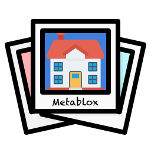

  

<h1 align="center">Metablox</h1>

  <strong>Travel memories, kept with the real places they happened.</strong>

  Capture a moment on a trip and pin it to that place. City hubs collect 
  what people left there. A <strong>Blox</strong> is the place on the map — ownership 
  that keeps the spot and its stories together.

  
  &nbsp;
  
  &nbsp;
  

  <a href="https://metablox.co"><strong>metablox.co</strong></a>
  &nbsp;·&nbsp;
  <a href="https://metablox.co/explore/">Explore</a>
  &nbsp;·&nbsp;
  <a href="https://metablox.co/cities/">All city hubs</a>
  &nbsp;·&nbsp;
  <a href="https://metablox.co/guides/">Guides</a>

## City hubs are live

Open a hub and read the public memories attached to real places there.

| | | |
| --- | --- | --- |
| [San Francisco](https://metablox.co/cities/san-francisco/) | [New York](https://metablox.co/cities/new-york/) | [Singapore](https://metablox.co/cities/singapore/) |
| [Taipei](https://metablox.co/cities/taipei/) | [Los Angeles](https://metablox.co/cities/los-angeles/) | [Seattle](https://metablox.co/cities/seattle/) |

Also live: [Manchester, Connecticut](https://metablox.co/cities/manchester-connecticut/), [Bristol, Connecticut](https://metablox.co/cities/bristol-connecticut/), and [Clinton, Connecticut](https://metablox.co/cities/clinton-connecticut/).

**15,550** public memories · **147** countries and territories · **112** published guides  
Snapshot on the [about page](https://metablox.co/about/), 2026-10-25.

## People

**Kevin Huang | Founder, Metablox**

Yu-kai Chou | Chair

## Community

- [Discord](https://discord.gg/xXxJs8HxPZ)
- [X](https://x.com/MetabloxNFTs)
- [Medium](https://medium.com/metablox)
- [About Metablox](https://metablox.co/about/)
- Apps: [App Store](https://apps.apple.com/tw/app/metablox-co/id6742415030) · [Google Play](https://play.google.com/store/apps/details?id=co.metablox.app)
- Developers: [MCP documentation](https://metablox.co/mcp/mcp-docs/)

  Metablox, Inc. · <a href="https://metablox.co">metablox.co</a>

